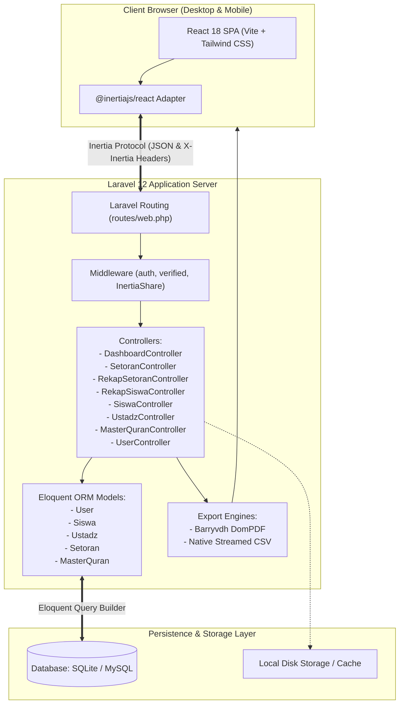
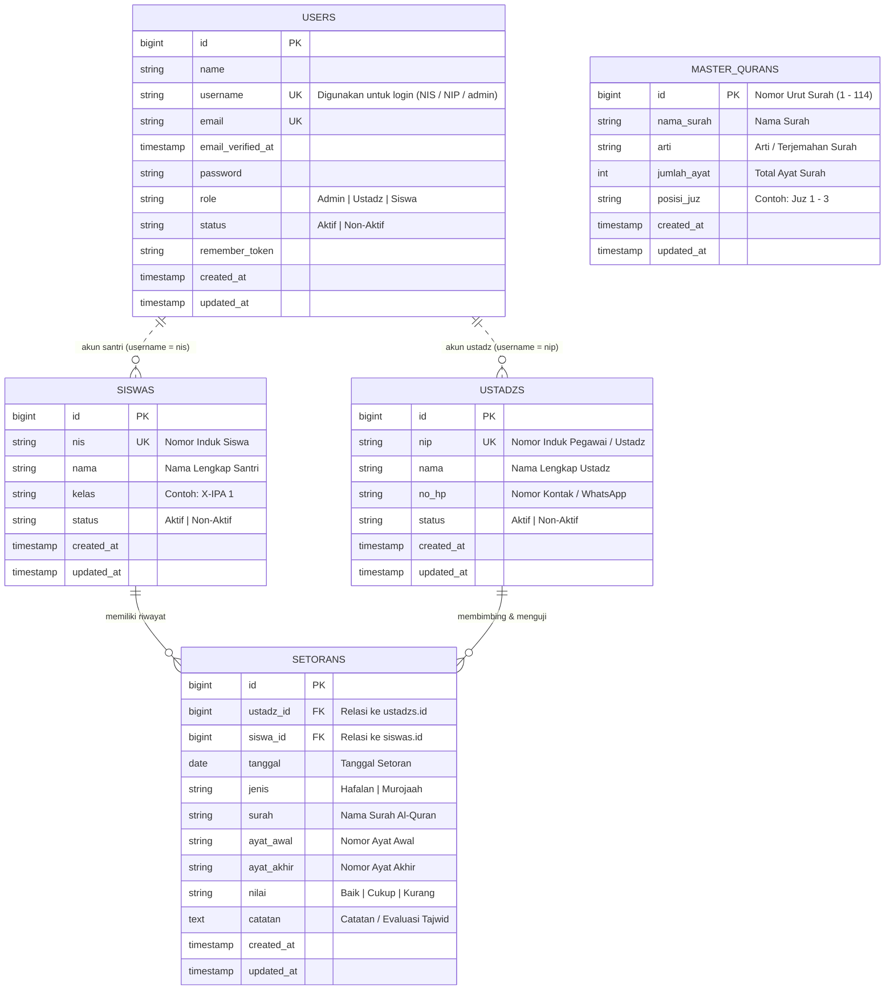
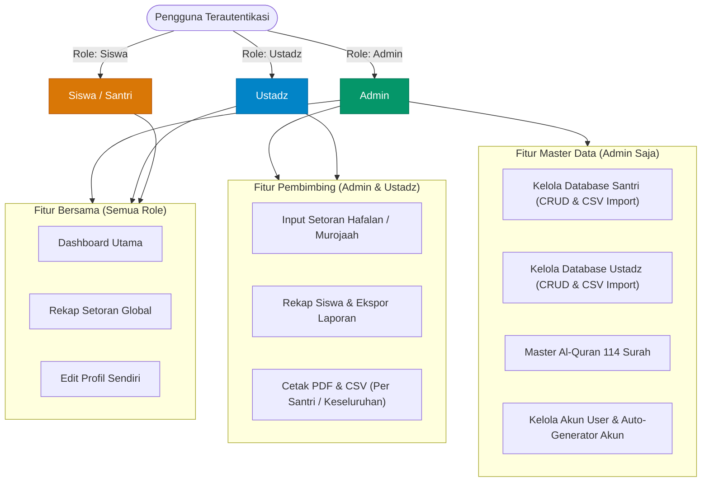
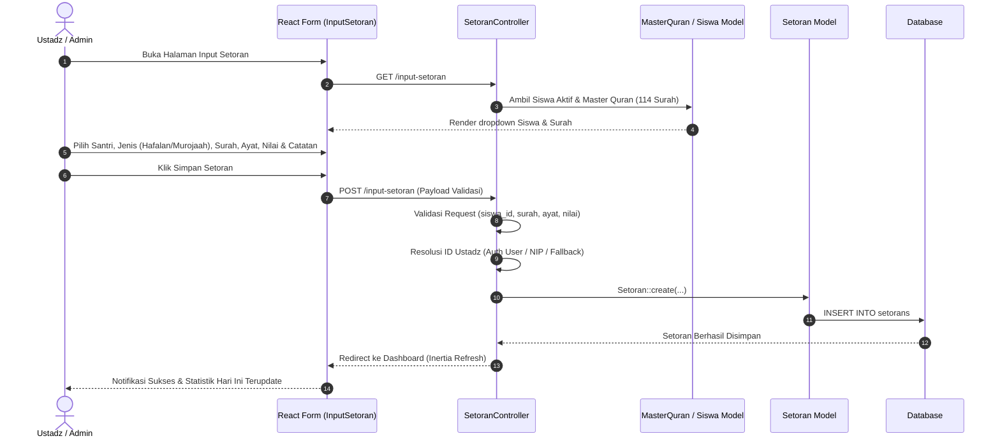
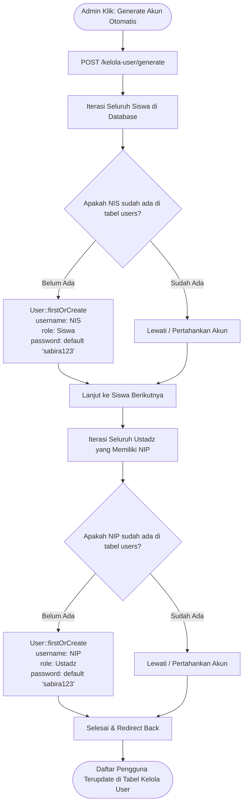
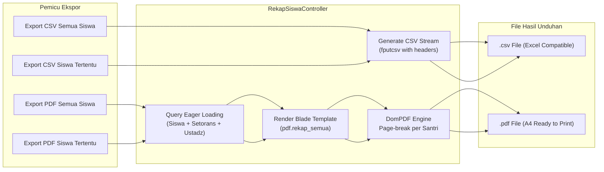
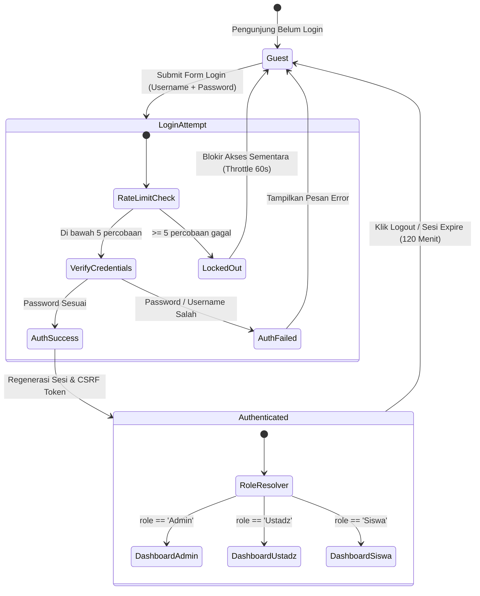

# Dokumentasi Graphify & Arsitektur Sistem - Sabira Tahfidz

Dokumen ini menyediakan representasi visual berbasis graf (*graphify*) dan diagram teknis mendalam mengenai arsitektur, basis data, alur bisnis, serta keamanan aplikasi **Sabira Tahfidz**.

---

## 1. Arsitektur Komponen Sistem (*System Architecture*)

Aplikasi menggunakan pola arsitektur **Monolith Modern** (*Modern Monolith*) dengan integrasi **Inertia.js** yang menghubungkan backend Laravel 12 secara langsung ke frontend SPA React 18 tanpa memerlukan API REST konvensional.

---

## 2. Entity Relationship Diagram (ERD)

Struktur data dirancang ternormalisasi dengan referensial integritas (`foreignId` dengan `onDelete('cascade')`).

---

## 3. Matriks Hak Akses & Role-Based Access Control (RBAC)

Sistem membedakan hak akses pengguna menjadi 3 tingkat wewenang (*role*):

---

## 4. Alur Bisnis Input Setoran (*Hafalan & Murojaah Flow*)

Proses pencatatan setoran hafalan baru atau murojaah oleh Ustadz/Admin:

---

## 5. Alur Pembuatan Akun Otomatis (*Mass Account Generator*)

Memudahkan administrator membuat akun secara instan untuk seluruh santri (berbasis NIS) dan seluruh ustadz (berbasis NIP) tanpa membuat akun satu per satu:

---

## 6. Alur Pelaporan & Ekspor Data (*Reporting & Export Pipeline*)

Sistem mendukung ekspor rekapitulasi baik secara massal maupun personal untuk setiap santri:

---

## 7. Status & Siklus Sesi Autentikasi (*Authentication State Machine*)

